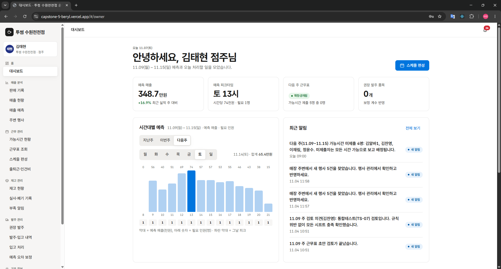
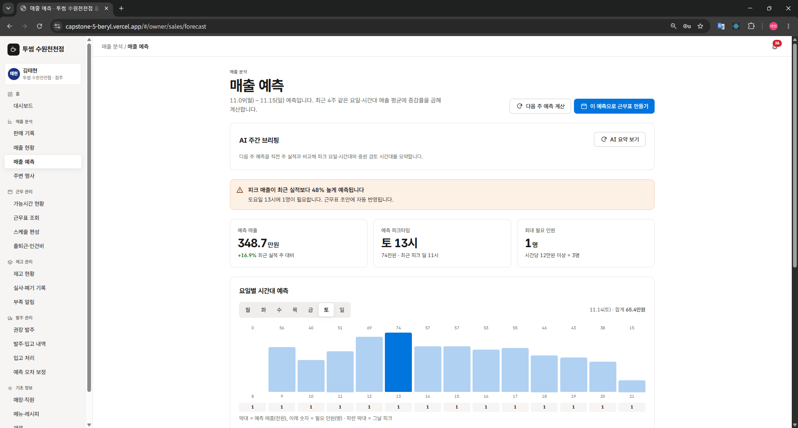
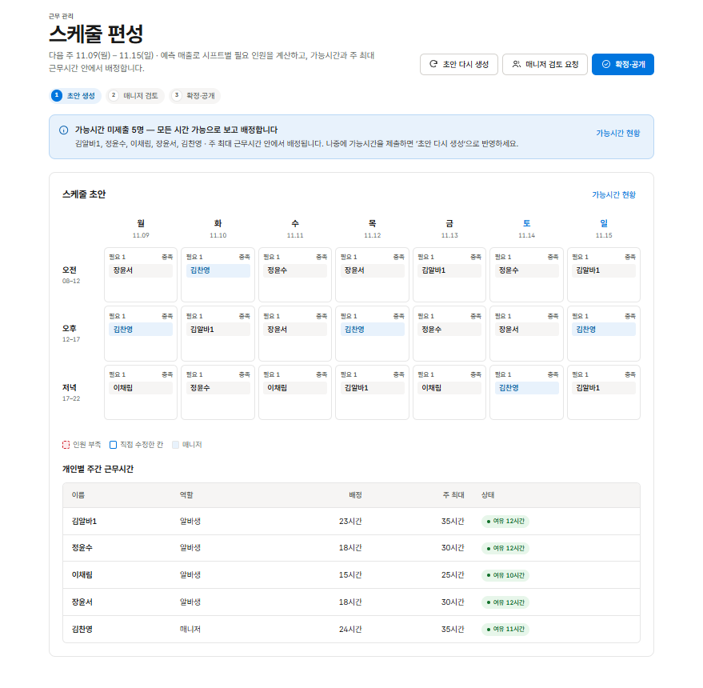

# 카페·식당 매출예측·근무표 자동화 솔루션

> "감이 아니라 데이터로 발주하고 근무표 짜는 카페"
> 매출 데이터를 분석해 피크타임을 파악하고, 근무 스케줄과 재료 발주량을 자동으로 산출하는 **웹 서비스**(프로토타입)

**팀**: 컴퓨터소프트웨어과 3A 5조 (6명) — 역할은 [팀원 역할](#팀원-역할) 참고
**지도교수**: 김규억 / **참여업체**: 나모웹비즈 주식회사
**개발 기간**: 2026.10.14 ~ 2026.11 (클라우드캡스톤디자인2)

---
## Screenshot
| 점주 · 대시보드 | 점주 · 매출 예측 | 점주 · 스케줄 편성 |
|:---:|:---:|:---:|
|  |  |  |

| 매니저 · 실사·폐기 기록 | 알바생 · 근무표 (모바일) | 알바생 · 부족 신고 (모바일) |
|:---:|:---:|:---:|
|  |  |  |

---
## 접속

**[카페 온기 운영 관리](https://capstone-5-beryl.vercel.app/)**
```
https://capstone-5-beryl.vercel.app/
```
점주로 회원가입한 뒤 매장을 등록하면 전체 기능을 써 볼 수 있습니다. 직원(매니저·알바생)은 점주가 이메일로 초대합니다.

---
## 프로젝트 한 줄 요약

- **무엇을**: 카페·식당의 매출 예측, 근무표 자동 생성, 재고·발주 관리 웹 서비스
- **왜**: 발주와 인력 배치를 감으로 정해 재료 폐기와 인건비 낭비가 생기고, 예측과 실제의 오차를 보정할 체계가 없어서
- **어떻게**: 판매 기록을 요일·시간대별로 집계해 피크타임과 필요 인원·소진량을 예측하고, 오차를 매주 보정해 다음 발주에 반영

## 해결하려는 문제
- 발주와 인력 배치를 감으로 정해 재료 폐기와 인건비 낭비가 생긴다.
- 피크 시간대에는 인력이 부족하고 한산할 때는 남는다.
- 예측과 실제의 오차를 사후에 보정하는 체계가 없다.

---
## 주요 기능
| 영역 | 내용 |
|---|---|
| 매출 예측 | 판매 기록(CSV 업로드·직접 입력)을 요일·시간대별로 집계하고 피크타임과 다음 주 매출을 예측 |
| 근무 스케줄 | 알바생 가능시간 등록 → 스케줄 초안 자동 생성 → 매니저 검토 → 점주 확정·공개 |
| 출퇴근·급여 | 출퇴근 기록, 지각·조퇴 표시, 급여 계산, 예정·실제 인건비 비교 |
| 재고·알림 | 판매 시 레시피 기준 재고 자동 차감, 최소 보유량 미달·부족 신고 알림 |
| 발주·입고 | 예측 소진량과 보정 계수를 반영한 권장 발주량, 발주 등록, 입고 처리 |
| 오차 보정 | 기간 마감 후 오차·폐기 리포트와 보정 계수를 다음 발주에 반영 |
| 기초 정보 | 매장·직원 초대, 메뉴·재료·레시피 등록(CSV 일괄 등록 지원) |
| 주변 행사 반영 | 매장 반경 안 행사 정보를 불러와 예측에 반영(시험 기능) |

사용자는 **점주 · 매니저 · 알바생** 3종이며 역할별로 볼 수 있는 화면과 데이터가 다릅니다.

---
## 주요 문서

| 문서 | 무슨 내용 | 언제 보면 되나 |
|---|---|---|
| **[`docs/프로젝트_배경.md`](docs/프로젝트_배경.md)** | 의뢰 배경, 페르소나, 산출물 폴더 안내 | 처음에 프로젝트를 이해할 때 |
| **[`docs/설계_프로세스·이벤트.md`](docs/설계_프로세스·이벤트.md)** | 프로세스 26개, 우선순위, 스윔레인, 이벤트 설계 | 기능이 왜 이렇게 동작하는지 볼 때 |
| **[`docs/데이터_구조.md`](docs/데이터_구조.md)** | 테이블 22개 확정 내용, 통폐합 이력, 관계 규칙 | DB 구조를 볼 때 |
| **[`인수인계_메모.md`](인수인계_메모.md)** | 구현 현황, 이어서 작업할 때 알아야 할 점 | 작업을 이어받을 때 |
| **[`산출물/`](산출물/)** | 주차별 설계 산출물(프로세스·이벤트·데이터 설계, 발표 자료) | 설계 원본이 필요할 때 |

---
## 기술 스택

| 분야 | 기술 |
|---|---|
| 프론트엔드 |    |
| 백엔드 |   |
| 데이터베이스 |  |
| 배포 |  |
| 테스트 |  Node test runner, PGlite(DB 로직) |

---
## 팀원 역할

| 이름 | 역할 | 담당 |
|---|---|---|
| 김태현 (학생대표) | 총괄·풀스택 | DB 설계·권한(RLS)·이벤트(트리거·스케줄러), 출퇴근·급여, 재고·발주·입고, 오차 보정, 주변 행사 반영, Edge Function, 배포·저장소 관리 |
| 김찬영 | 프론트엔드·백엔드 | 인증·RLS, 1-2 요일·시간대별 매출 조회, 1-3 피크타임·예측 매출 |
| 장윤서 | 프론트엔드·백엔드 | 2-1 가능시간 등록·수정, 2-3 스케줄 초안 자동 생성 |
| 이채림 | 프론트엔드·백엔드 | 2-4 초안 검토·수정, 2-5 확정·공개, 2-6 확정 스케줄 조회 |
| 정윤수 | 프론트엔드·백엔드 | 판매 기록 입력·CSV 업로드, 가능시간 현황, 기초 정보(매장·직원·메뉴·재료·레시피) 등록 |
| 김기연 | 기획·문서 | 요구사항·설계 산출물 정리, 테스트·시연 지원 |

---
## 설계 포인트
- 프로세스 7개 대분류·26개 소분류를 우선순위(상·중·하)대로 구현했고, 프로세스 → 이벤트 → 데이터의 3층으로 설계했습니다.
- 테이블은 22개로 통폐합해 확정했습니다(스케줄 초안·확정 통합, 폐기 기록을 재고 변동에 흡수 등).
- 권한은 DB의 RLS와 함수 단위 검사로 처리합니다. 직원 정보·급여는 점주와 본인만, 매니저는 근무표 조회와 검토만 가능합니다.
- 주간 마감, 근무 전 리마인드, 가능시간 알림 같은 이벤트는 DB 트리거와 pg_cron으로 자동 실행합니다.
- 판매 기록은 POS 연동 없이 CSV 업로드·직접 입력으로 받습니다. 그래서 오차 보정의 기간 마감은 점주가 수동으로 실행합니다.

## 폴더 구조
```
app/                 React 웹앱 (src/features, domain, state, lib …)
supabase/
  migrations/        DB 스키마·함수·정책 마이그레이션
  functions/         Edge Function (ai-insight, invite-employee, sync-local-events)
  tests/             DB 권한·로직 SQL 테스트
data/
  seed/              시연용 시드 SQL (가상·시연용 가공 데이터)
  samples/           판매 기록·메뉴·재료·레시피 샘플 CSV
docs/                단계별 구현 문서, 연결·설계 메모, 피드백(점검 기록)
prototype/           초기 화면 프로토타입(단일 HTML)
산출물/               주차별 설계 산출물(프로세스·이벤트·데이터 설계)
```

## 실행 방법
```bash
cd app
npm install
npm run dev
```
`app/.env.local`에 아래 환경변수가 필요합니다. 공개용(publishable) 키만 사용하며 시크릿 키는 저장소에 두지 않습니다.
```
NEXT_PUBLIC_SUPABASE_URL=<본인 Supabase 프로젝트 URL>
NEXT_PUBLIC_SUPABASE_PUBLISHABLE_KEY=<본인 프로젝트의 공개용 키>
```
DB는 `supabase/migrations`를 순서대로 적용하면 구성됩니다.
